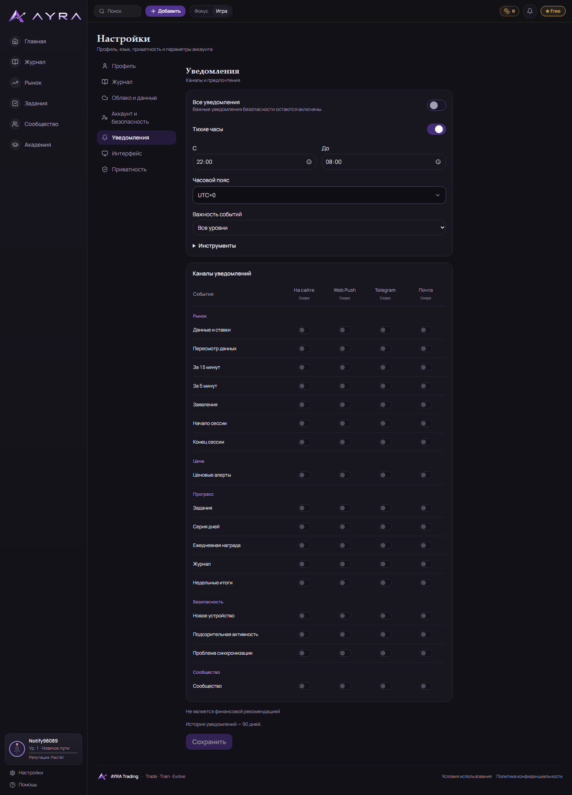
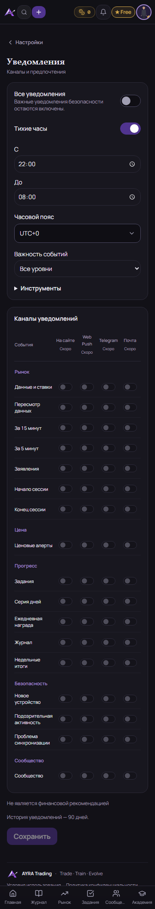
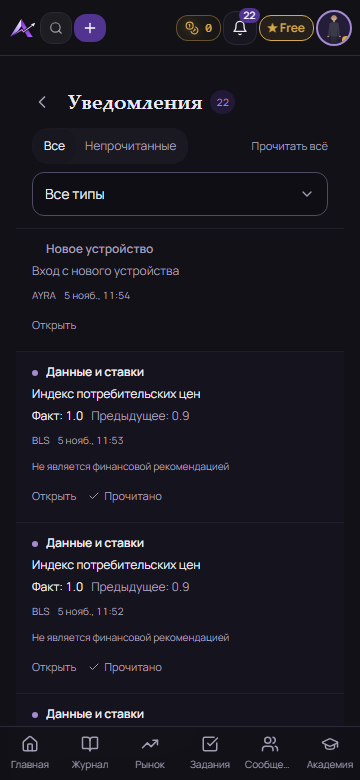
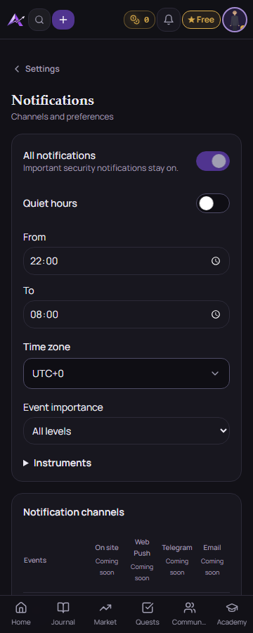

# PR 1 уведомлений: журнал проверок

Проверки выполняются локально, без production SQL, изменения Vercel или отправки внешних уведомлений. Итоговые результаты CI дополнительно указаны в Draft PR. Тестовые записи существуют только в PGlite и перехваченных ответах браузерного теста.

## Успешные проверки

### Одобренный центр: desktop Popover и мобильная страница

5 ноября владелец одобрил новый интерфейс. Desktop: существующий Popover шириной 400 px под колокольчиком, без затемнения, прокрутка списка, Select AYRA. Mobile: обычная страница `/notifications`, «Назад» и browser Back. Список/фильтры/явное прочтение общие; backend, RLS, миграции и доставка не менялись. Неактивные внешние возможности остаются неактивными.

Финально локально: **730/730 Vitest PASS**, TypeScript PASS, lint PASS (прежние предупреждения), расширенный browser **1/1 PASS** на dev-сервере. Проверены 1440/360, RU/EN, оба способа возврата со страницы, direct link, Esc/клик снаружи/Tab для Popover, вложенный фильтр с клавиатуры, счётчик, прокрутка, пагинация и явное прочтение. Production build локально по-прежнему ограничен Windows EPERM; Linux CI на новом коммите проверяется отдельно.

Скриншоты содержат исключительно тестовые записи:

- [Desktop](screens/notifications/notifications-popover-desktop.png)
- [Пустой desktop](screens/notifications/notifications-popover-empty.png)
- [Прочитанные и непрочитанные](screens/notifications/notifications-popover-test-list.png)
- [Мобильная страница](screens/notifications/notifications-mobile-page.png)
- [Пустая мобильная страница](screens/notifications/notifications-mobile-empty.png)

### Ошибки при доработке центра

Сценарий: `e2e-supabase/notifications.spec.ts > notifications: inbox, explicit read, pagination, filters, cloud settings, RU/EN and responsive layouts`.

- Замер на анимации: `Error: expect(received).toBeLessThanOrEqual(expected)`, `Expected: <= 2`, `Received: 3.3231201171875`. Геометрия проверяется с reduced motion, допуск не ослаблен.
- Фокус: `Error: expect(locator).toBeFocused() failed`, locator `getByTestId('notification-center').getByRole('button', { name: 'Все', exact: true })`, `Expected: focused`, `Received: inactive`. Исправлено ожидание видимости элемента перед фокусом.
- Вложенный Esc: `Error: expect(locator).toBeVisible() failed`, locator `getByTestId('notification-center')`, `Expected: visible`, `Error: element(s) not found`. Исправлена граница Select portal и порядок Esc.
- Выход по Tab: `Error: expect(locator).toHaveCount(expected) failed`, locator `getByTestId('notification-center')`, `Expected: 0`, `Received: 1`. На границе Popover окно закрывается с возвратом фокуса.
- После добавления страницы: `Error: expect(locator).toContainText(expected) failed`, locator `getByTestId('notification-settings').getByRole('alert')`, `Expected substring: "unavailable right now"`, `Timeout: 5000ms`, `Error: element(s) not found`. Тест ожидал reload раньше завершения возврата; добавлено ожидание URL настроек.

Повторные проверки прошли. Тестовый HEAD fixture дополнен `access-control-expose-headers: content-range`, как в реальном Supabase; логика счётчика не менялась.

### Предыдущий CI до публикации одобренного центра

[Run 41903769914](https://github.com/Malkis99/ayra_trading/actions/runs/41903769914), коммит `c7ca6b2`: `check` success, `e2e` failure. Mock-auth suite прошёл; в fake-Supabase suite 104 passed / 2 failed. Эти сценарии находятся вне центра уведомлений; их код не менялся, связь с PR не объявляется исключённой без повторной проверки.

1. `e2e-supabase/guest-journal-transfer.spec.ts:48:7 > Guest journal into the account (variant A) > after onboarding: «Move the guest journal» → trades in the cloud, badge «saved»; level, XP and Coins stay with the guest`:

   `Error: expect(received).toBe(expected) // Object.is equality`

   `Expected: 2`

   `Received: 0`

   `Timeout 20000ms exceeded while waiting on the predicate`

2. `e2e-supabase/journal-day-in-life.spec.ts:125:7 > Cloud journal: a day in the life (T7b-4f) > part 1: first upload → empty phone → create/edit/delete → offline → both conflict choices > 12: offline on B — badge «no network», 1 waiting; back online → sent, on A`:

   `Error: expect(received).toEqual(expected) // deep equality`

   Expected: `["NAS100", "USDJPY"]`; received: `["GBPUSDUSDJPY", "NAS100"]`.

   `Timeout 30000ms exceeded while waiting on the predicate`

Журнал и его тесты в этой доработке не изменялись. Результат нового CI фиксируется в описании PR.

### Доработка интерфейса по решению владельца 5 ноября

Технические тексты убраны из UI; оставлены в roadmap/PR. Названия сокращены, «Все уведомления» инвертирует только представление `all_disabled`, quiet/filter/retention правила не меняются. Вместо карточек — таблица четырёх каналов с неактивными переключателями и кратким «Скоро»; мобильный канал остаётся в архитектуре/roadmap. Общие компоненты, другие страницы, Supabase/RLS/доставка не изменены.

TypeScript, целевые UI/policy/i18n тесты и браузерный сценарий прошли после переделки. Проверяется обе стороны общего выключателя с неизменностью остальных настроек. Новых падений тестов при этой UI-доработке не было. Снимки 1440/360 обновлены; сравнение с Profile/Journal/Interface/Privacy выполнено по исходным компонентам и локальным страницам.

Итог повторного полного набора после доработки: **729/729 Vitest PASS**, TypeScript PASS, lint PASS (только прежние предупреждения), browser 1/1 PASS. На исходном коммите PR Linux CI `check` также подтвердил production build и миграции/RLS; для UI-коммита CI запускается заново.

- `npx tsc --noEmit`: прошёл.
- `npm run lint`: прошёл; существующие предупреждения в login/journal не изменялись. Нового предупреждения в notifications нет после исправления cleanup.
- Полный `npx vitest run`: 728/728 после исправления локализации и тестовых mocks. После последующих изменений выполняются целевые повторные проверки; итог CI — в PR.
- `node scripts/test-migrations.mjs`: прошли A–K, в том числе повторное применение 0011, SQL RLS и проверка grants.
- `git diff --check`: прошёл.
- `npx playwright test -c playwright.supabase.config.ts notifications.spec.ts`: 1/1 прошёл на локальном dev-сервере. Проверены повторное чтение настроек второй вкладкой, явное прочтение, пагинация, фильтры, unavailable/setup состояния, RU/EN и 360/1440. Скриншоты визуально проверены и сохранены в `docs/screens/notifications`.

### Скриншоты (только локальные тестовые записи)

## Ошибки, найденные и исправленные при разработке

1. `lib/game.test.ts > T4.1 i18n & State Purity Audits > (b) ru values do not contain disallowed English words`:

   `Error: Disallowed English word "IANA" found in RU dictionary at key ".notifications.timezone": "Часовой пояс уведомлений (IANA)"`

   Подпись переведена. Для названий каналов Web Push/Email добавлены только соответствующие названия в существующий allowlist, без отключения аудита.

2. Тот же тест при повторном запуске:

   `Error: Disallowed English word "push" found in RU dictionary at key ".notifications.channels.mobile_push": "Мобильные push — позже"`

   Заменено на «Мобильные уведомления — позже». Повторный аудит прошёл.

3. `components/notifications/notifications.test.tsx > notification UI boundaries > keeps an unsuccessful save dirty, and does not claim success`:

   `Unable to find an accessible element with the role "switch" and name "Отключить обычные уведомления"`

   И `... > shows pending functions honestly, with English-only visible text`:

   `Unable to find an accessible element with the role "switch" and name "Web Push"`

   Существующий Toggle включает description в доступное имя. Исправлены селекторы тестов на начало имени; сам общий компонент не изменялся.

4. После переиспользования существующего TimezoneSelect три теста `never saves defaults after initial cloud read failed`, `keeps an unsuccessful save dirty, and does not claim success`, `shows pending functions honestly, with English-only visible text` упали с одинаковой ошибкой тестового mock:

   `[vitest] No "useOptionalApp" export is defined on the "@/lib/context" mock. Did you forget to return it from "vi.mock"?`

   Mock дополнен для существующего Select; все 7 component/hook тестов прошли повторно.

## Ошибки локального окружения

Браузерный сценарий `notifications: inbox, explicit read, pagination, filters, cloud settings, RU/EN and responsive layouts` дошёл до последней проверки отсутствующей миграции, затем тестовый селектор упал:

`Error: strict mode violation: getByRole('alert') resolved to 2 elements:`

`1) 
…
 aka getByTestId('notification-settings').getByRole('alert')`

`2) 

`

Селектор ограничен секцией уведомлений, чтобы не выбирать служебный route announcer Next.js.

- Первый `npm ci`:

  `Error: EPERM: operation not permitted, mkdir 'C:\Users\malki\Documents\Codex\2026-11-04\github-plugin-github-openai-curated-remote\work\ayra_trading\node_modules\@testing-library\dom'`

  После выдачи записи и повторного запуска с локальным cache зависимости установлены, lockfile не менялся.

- `npm run build` несколько раз остановился до завершения webpack. Точный первый текст:

  `Error: EPERM: operation not permitted, mkdir 'C:\Users\malki\Documents\Codex\2026-11-04\github-plugin-github-openai-curated-remote\work\ayra_trading\.next\static\chunks\app'`

  Другие попытки сообщали тот же EPERM для `.next\server\app\api\market-feeds`, `.next\types\app\api\market-feeds`, `.next\server\app\auth`, `.next\types\app` и `.next\types\app\legal`. В коротком рабочем пути на Node 20 (как в CI) последняя ошибка:

  `Error: EPERM: operation not permitted, mkdir 'C:\Users\malki\Documents\Codex\work\ayra147\.next\static\chunks'`

  Изменение короткого локального пути, выдача прав и временная проверка без build worker не устранили ошибку. Конфигурация Next/dependencies восстановлена и не входит в diff. Локальная production-сборка **не объявляется успешной**; стандартная Linux CI проверка остаётся обязательной. Dev-сервер запускается и используется для локальной browser-проверки.

- Первый запуск `npx playwright test -c playwright.supabase.config.ts notifications.spec.ts` не начал сценарий:

  `Error: browserType.launch: Executable doesn't exist at C:\Users\malki\AppData\Local\Packages\sandbox.{5bb515a8-b9fc-4979-9611-dbd0021e4868}\AC\ms-playwright\chromium_headless_shell-1243\chrome-headless-shell-win64\chrome-headless-shell.exe`

  Установлен браузер Playwright в отдельный локальный каталог вне репозитория, затем выполнен повторный запуск.

Ни одна из этих ошибок не исправлялась изменением production, зависимостей проекта, ослаблением RLS или отключением обязательных тестов. Результат браузерной проверки и ссылки на screenshots/CI приведены в Draft PR.
